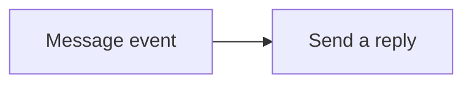

# DisFlow documentation

The documentation website for DisFlow, built with [Astro](https://astro.build) and
[Starlight](https://starlight.astro.build).

## Commands

Run these from `apps/docs` (or use the root `docs:*` scripts):

| Command | Action |
| --- | --- |
| `yarn dev` | Start the docs dev server on `http://localhost:4321` |
| `yarn build` | Build the static site into `dist/` |
| `yarn preview` | Preview the production build locally |
| `yarn check` | Run `astro check` to type-check the project |

From the repository root:

```bash
yarn docs:dev
yarn docs:build
yarn docs:preview
```

## Content

Every page is a Markdown or MDX file under `src/content/docs/`. The URL is derived from the
file path, so `src/content/docs/guides/editor.md` becomes `/guides/editor/`.

- `src/content/docs/index.mdx` — landing page.
- `src/content/docs/getting-started/` — create your first bot.
- `src/content/docs/guides/` — editor, blocks, events, commands, variables, export, hosting.
- `src/content/docs/help/` — troubleshooting, data safety, permissions, glossary.
- `src/content/docs/reference/` — block reference.
- `src/content/docs/self-hosting.md` — running the app from source.

Navigation is declared in the `sidebar` option of `astro.config.mjs`. Add a new page there or it
will only be reachable by direct link (Starlight still generates the route).

## Diagrams

Mermaid diagrams are supported through `astro-mermaid` + `mermaid`. Write them as ordinary fenced
code blocks:

````markdown

````

The integration is registered **before** Starlight in `astro.config.mjs` and follows the site's
light/dark theme automatically. Diagrams are rendered in the browser; keep them small and prefer
short labels so they stay readable on mobile.

## Deployment

`yarn build` produces a fully static site in `dist/`. Deploy that folder to any static host
(Cloudflare Pages, Netlify, Vercel, GitHub Pages, …).

Set a production URL in `astro.config.mjs` before deploying:

```js
export default defineConfig({
	site: "https://docs.example.com",
	// ...
});
```

Adding `site` enables canonical URLs and the generated sitemap.
