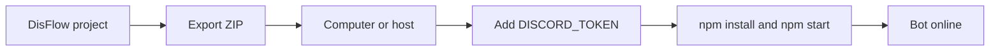

A bot is online only while its start command is running. Closing the terminal stops the bot, and
so does a computer going to sleep. These instructions are also included in your README.md in your exported
zip file :)



## Choose where it runs

| Option | Good for | Keep in mind |
| --- | --- | --- |
| Your own computer | Testing and small personal bots | The computer must stay on and awake |
| A hosting service | Bots that should always be online | Usually a monthly cost or a free tier with limits |
| A VPS | Full control | You manage updates, security and restarts |

## On your own computer

1. Unzip your exported bot into a folder.
2. Run `npm install` once.
3. Add your token to `.env`.
4. Run `npm start`.

Leave the terminal open. If the computer sleeps, the bot goes offline until it wakes up.

For a more permanent setup you can run the bot under a process manager that restarts it after a
crash, but for most people a hosting service is simpler.

## On a hosting service

The exact buttons differ between providers, but the steps are the same:

1. Create a **Node.js 18+** app or service and upload the unzipped bot files, or connect a Git
   repository containing them.
2. Set the **install command** to:

   ```bash
   npm install
   ```

3. Set the **start command** to:

   ```bash
   npm start
   ```

4. Add environment variables in the host's settings:

   ```dotenv
   DISCORD_TOKEN=your-bot-token
   ```

   Add any other variables you exported from DisFlow here too. Do not upload the `.env` file
   itself.

5. Start the service and open its logs. Watch the first few lines for errors; if the process exits
   immediately, the log usually names the problem.

Popular options include Railway, Render, Fly.io and a small VPS. Free tiers often sleep idle apps,
which takes the bot offline until it is woken.

:::caution[Database blocks and hosting disks]
The **Database** blocks write a `db.json` file in the bot's folder. On hosts with temporary storage,
that file can disappear when the app restarts or redeploys. Use a host with persistent disk
storage, or keep regular copies of `db.json`.
:::

## Updating your bot

1. Change and save the graph in DisFlow.
2. Select **Export bot**.
3. Replace the bot files on the computer or host.
4. Run `npm install` if the export added new dependencies.
5. Restart the bot.

## Keep these rules in mind

- Run each bot token in **one place** at a time.
- Keep `.env` private — it contains your token in plain text.
- Check the logs after every update.
- Test changes on a small server before using them in a busy one.

## Related pages

- [Exporting your bot](/guides/exporting/)
- [Troubleshooting](/help/troubleshooting/)
- [Permissions and safety](/help/permissions/)
