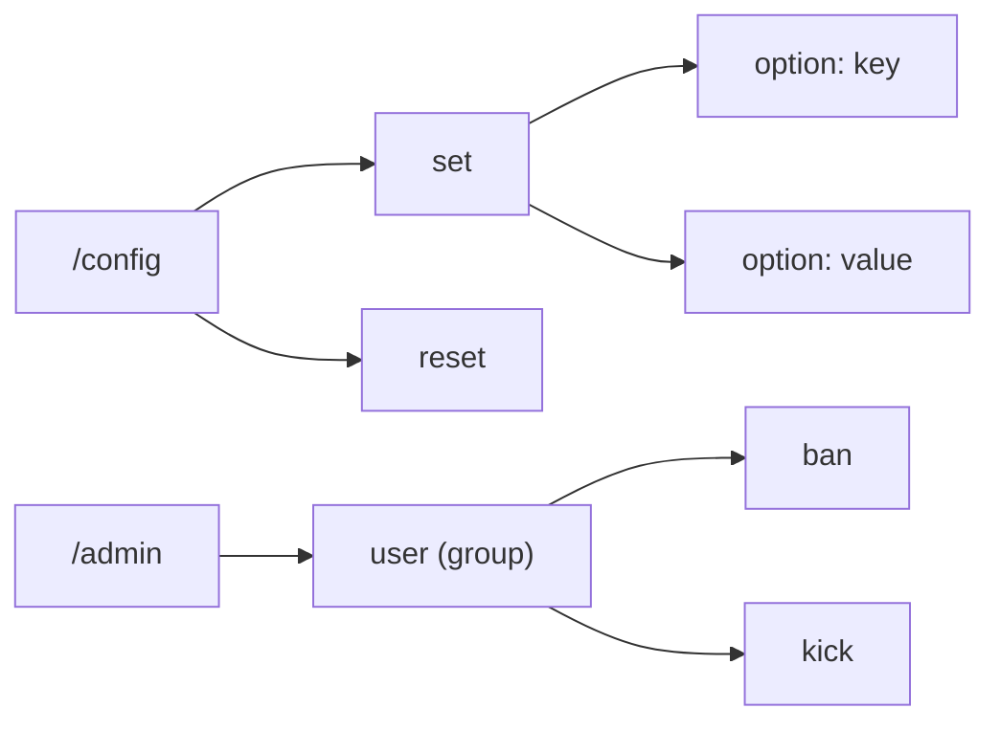

Slash commands are the commands members type in Discord, such as `/ping` or `/help`. Each command
has its own name, description, options and graph.

## Create a command

1. Open **Commands** and select **Create command**.
2. Enter a name and description.
3. Add any options you need.
4. Select **Create** to save it.
5. Open the command to build its behaviour.

Command names should be lowercase and follow Discord's rules. DisFlow uses the same limits Discord
does, so anything it accepts will work in Discord.

## Command options

Options are the extra pieces of information a member provides. For example, `/ban user:@name
reason:spam` has two options: `user` and `reason`.

| Option type | Use it for |
| --- | --- |
| Text | A short piece of text |
| Integer | A whole number |
| Number | A number with decimals |
| True/False | A yes/no choice |
| User | A server member |
| Channel | A channel |
| Role | A role |
| Mentionable | A user or role mention |
| Attachment | An uploaded file |
| Subcommand | A named branch, such as `/config set` |
| Subcommand group | A group of subcommands |

Some options have extra settings:

- **Required** — the member must provide it.
- **Choices** — a fixed list of answers to pick from.
- **Minimum / maximum** — limits for numbers and text length.
- **Autocomplete** — suggestions appear as the member types.
- **Allowed channel types** — restrict a channel option to specific kinds of channels.

Discord does not allow autocomplete and fixed choices on the same option.

## Organising commands

You can keep related commands together with subcommands and groups:

- `/config set` and `/config reset` are subcommands of `config`.
- `/admin user ban` is a subcommand inside the `user` group.

Discord has rules about mixing these:

- A command cannot have both plain options and subcommands.
- A group can only contain subcommands.
- A subcommand can only contain plain options.
- Groups are only allowed at the top level.
- Each level can have at most 25 options.

DisFlow checks these rules as you build, so you cannot save an invalid command.

## Building the response

Open the command editor and use the interaction blocks:

- **Get Command Option** reads an option by name.
- **Get Subcommand** and **Get Subcommand Group** tell you which branch was used.
- **Subcommand Match** compares the invoked subcommand to a value.
- **Get Focused Option** is used for autocomplete suggestions.

To reply, use one of these:

| Block | What it does |
| --- | --- |
| Reply To Interaction | Sends the first response |
| Defer Reply | Says “working on it” and gives you more time |
| Edit Reply | Changes the response after deferring |
| Delete Reply | Removes the response |
| Follow Up | Sends another message after the first reply |
| Update Interaction | Updates a button or menu interaction |
| Defer Update | Acknowledges a button or menu without changing it |
| Show Modal | Opens a pop-up form |
| Respond To Autocomplete | Sends autocomplete suggestions |

:::caution[Reply quickly]
Discord expects an answer within three seconds. If your command needs longer — for example it calls
an external service — start with **Defer Reply**, then use **Edit Reply** when you have the result.
:::

## Example: /ping

1. Create a command named `ping` with the description “Check that the bot is online”.
2. Open its editor.
3. Add **Reply To Interaction** and connect it to **On Command**.
4. Set the reply text to `Pong! bot is online!`.
5. **Save**.

## If Interaction Create is also on

Your command and the **Interaction Create** event will both run for the same command. Use only one
of them, or check the interaction type first. See
[Events](/guides/events/#interaction-create-and-slash-commands).

## Related pages

- [Events](/guides/events/)
- [Connect blocks](/guides/flows/)
- [Permissions and safety](/help/permissions/)
- [Glossary](/help/glossary/)
