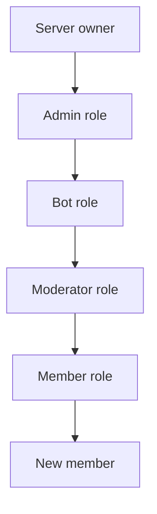

Discord controls what a bot can do with **permissions**. Giving the bot too few permissions makes
blocks fail; giving it too many can put your server at risk.

## How bot permissions work

There are two layers:

1. **Server permissions** — what the bot is allowed to do across the server.
2. **Channel permissions** — any extra limits or allowances on a specific channel.

A bot can only do something when both layers allow it. A channel can take a permission away even if
the bot has it server-wide.

Bots also have a **role hierarchy**. The bot's own role position decides whose roles it can manage.

## Invite your bot correctly

When you create the invite link in the Discord Developer Portal, select these scopes:

- `bot` — lets the bot join the server.
- `applications.commands` — lets the bot register slash commands.

If you forget `applications.commands`, slash commands will not appear in your server.

## Permissions by feature

| What you want to do | Permission needed |
| --- | --- |
| Read and reply to messages | View Channel, Send Messages, Read Message History |
| Send embeds | Embed Links |
| Upload files | Attach Files |
| Add reactions | Add Reactions, Read Message History |
| Delete, pin or bulk-delete messages | Manage Messages |
| Add or remove roles | Manage Roles |
| Create or delete roles | Manage Roles |
| Kick members | Kick Members |
| Ban or unban members | Ban Members |
| Time out members | Moderate Members |
| Change nicknames | Manage Nicknames |
| Move or disconnect members in voice | Move Members |
| Create, rename or delete channels | Manage Channels |
| Change channel topics or slowmode | Manage Channels |
| Change channel permissions | Manage Channels **and** Manage Roles |
| Create invites | Create Instant Invite |
| Create threads | Create Public Threads |
| Post in threads | Send Messages in Threads |
| Archive threads or manage members in them | Manage Threads |
| Slash commands | `applications.commands` scope, plus channel permissions to reply |
| Console, variables and database blocks | No Discord permission |

## Role hierarchy

The bot's highest role must be **above** any role it manages.

- A bot cannot give or remove a role that sits at or above its own highest role.
- A bot cannot moderate the server owner.
- A bot cannot moderate a member whose highest role is at or above the bot's highest role.
- This protects servers from a bot handing out power it should not have.

If a moderation block fails with a permissions error, move the bot's role higher in **Server
Settings → Roles**.

## Prefer specific permissions

**Administrator** gives the bot every permission and bypasses channel restrictions. It is
convenient, but a stolen token or a mistake in a graph then has full control of the server.

Use only the permissions your graphs need. Add more later if a block asks for them.

## Test safely

- Use a small private server before adding the bot to a busy community.
- Give it a dedicated role with limited permissions.
- Test moderation blocks such as **Kick** and **Ban** on an account you control or with a
  volunteer.
- Prefer **Timeout** while you are still testing.
- Add buttons with **Create Button** for destructive actions so a member has to confirm.

Server admins can review what the bot did in **Server Settings → Audit Log**. Bot actions appear
there like any other member's actions.

## Protect your token and secrets

Your bot token is effectively the bot's password:

- Never post it in Discord, screenshots, issues or public repositories.
- Keep `.env` out of Git; add it to your host's environment settings instead.
- DisFlow stores the token encrypted, but the exported `.env` is plain text.
- If a token is exposed, reset it in the Discord Developer Portal, update your bot's `.env` and
  restart the bot.

Environment variables can hold API keys for other services. Treat them the same way: use the
**Variables** page, export the `.env` only when needed, and never share it.

## If something goes wrong

- **Missing Permissions** in the logs — the bot lacks a permission, or its role is too low.
- **Missing Access** — the bot cannot see the channel at all. Check channel permissions.
- **Unknown Member** — the member may have left, or the bot cannot see them without the **Server
  Members** setting.

See [Troubleshooting](/help/troubleshooting/) for more.

## Related pages

- [Your data and safety](/help/your-data/)
- [Environment variables](/guides/environment-variables/)
- [Events](/guides/events/)
