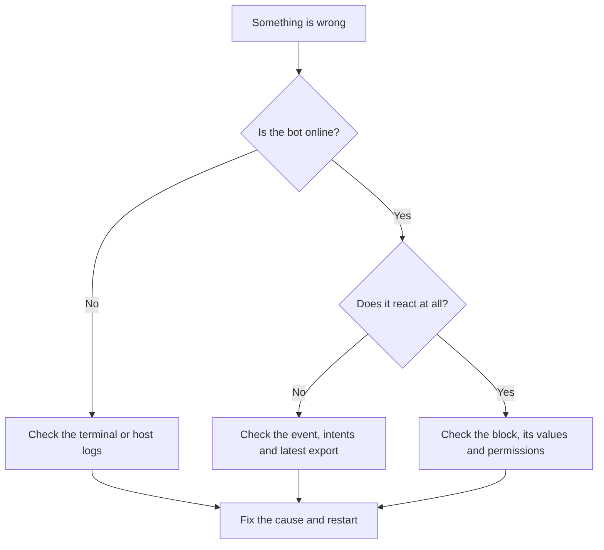

Most problems come down to one of three things: the bot is not running, a Discord setting is
missing, or the latest changes were not exported. Try these first.

## Quick checks

1. **Is the bot running?** The terminal or host must still be running `npm start`.
2. **Did you export after your last change?** Exporting takes a snapshot of your saved graphs.
3. **Did you restart the bot after exporting?** Replacing files does not restart a running bot.

## The bot is offline

| Check | What to do |
| --- | --- |
| The start command closed | Start the bot again with `npm start` and leave it running |
| `.env` is missing or misplaced | It must be named exactly `.env` and sit next to `index.js` |
| Token is wrong or was reset | Copy the current token from the Discord Developer Portal into `.env` |
| Dependencies are missing | Run `npm install` in the bot folder |
| The host is asleep | Free hosting plans often sleep when idle; open the host's dashboard and wake it |
| The token is running somewhere else | Stop the other copy — two copies of one token disconnect each other |

Read the terminal or host logs when the bot starts. Common messages:

- **An invalid token was provided** — `DISCORD_TOKEN` is wrong or out of date.
- **Used disallowed intents** — turn on the required setting in the Discord Developer Portal, then
  restart the bot.
- **Cannot find module** — run `npm install` again.

## The bot ignores messages

1. Turn on **Message Content** in the Discord Developer Portal under **Bot → Privileged Gateway
   Intents**.
2. Restart the bot after changing the setting.
3. Make sure the **Message** event is switched on in DisFlow and its graph is saved.
4. Export again and restart the bot.
5. Check that the bot can see the channel: it needs **View Channel** and **Read Message History**.
6. If you added **If** or **Text Includes**, confirm the condition actually matches the message.

## Member join or leave events do nothing

1. Turn on **Server Members** in the Discord Developer Portal.
2. Restart the bot.
3. Check that **Guild Member Add** or **Guild Member Remove** is switched on and saved.
4. Export again — events that were off at export time are not included.

## Slash commands do not appear

- **Invite the bot again** with the `applications.commands` scope. Use the invite link from the
  Developer Portal and make sure both `bot` and `applications.commands` are selected.
- **Restart the bot.** Commands are registered when the bot starts.
- **Export after adding the command.** A command without a saved graph is not included.
- **Wait a little.** Discord can take up to an hour to show new global commands for the first time.
  Restarting the Discord app or refreshing with <kbd>Ctrl</kbd>+<kbd>R</kbd> can help.

## The bot replies twice

You likely have both a slash command and the **Interaction Create** event handling the same
interaction. Turn off **Interaction Create**, or add a check so only one of them responds. See
[Events](/guides/events/#interaction-create-and-slash-commands).

## A block does nothing

- Trace the arrows from the start block. Blocks that are not connected to it never run.
- Check the condition of any **If**, **Switch** or **While** block on the way.
- Make sure data inputs are filled in — either type a value into the block or connect one.
- Save the graph, export, and restart the bot.

## “Get Property” returns nothing

- Use the right value for the event. A `member` exists in member events, not in message events.
- Check the path spelling and capitalisation, for example `author.username`.
- Some fields are optional, such as a nickname. Use **If** to handle missing values.

## Export fails

| Message | Fix |
| --- | --- |
| No event or command handler | Turn on at least one event or add a slash command, then save it |
| Graph is missing its start block | Do not delete **On Start** or the event block from a graph |
| The export is missing your latest changes | Save every graph before selecting **Export bot** |

## The bot can't manage roles or members

- The bot's role must sit **above** the role it is trying to manage.
- The bot needs the matching permission, such as **Manage Roles** or **Kick Members**.
- A bot can never moderate the server owner or someone with an equal or higher role.
- Some moderation actions, like timeouts, need **Moderate Members**.

See [Permissions and safety](/help/permissions/) for a full list.

## The bot disconnects or stops later

- Another copy of the bot may be running with the same token.
- The computer may have gone to sleep or lost its connection.
- The hosting plan may restart or sleep the bot. Check the host's logs.
- If the bot crashes, the last lines of the log usually name the block or value that caused it.

## I forgot my passcode

The passcode cannot be reset. It unlocks the bot token and environment variables stored in
DisFlow, and those values cannot be recovered without it.

Your saved graphs can still be opened, edited and exported. Your **exported bot keeps working**
because it uses the token in its own `.env` file. Only the locked token and variables are
unavailable.

## My changes are not in the bot

Exporting creates a copy of your bot; it does not update a running copy automatically.

1. Save the graph in DisFlow.
2. Select **Export bot**.
3. Replace the files on your computer or host.
4. Run `npm install` if the dependencies changed.
5. Restart the bot.

## Still stuck?

Open an issue on the [DisFlow GitHub repository](https://github.com/DisFlowTeam/disflow/issues)
and include:

- What you expected to happen.
- What actually happened.
- Any error message from the terminal or host logs.
- The event or command you were working on.

Never post your bot token, `.env` file or passcode in an issue.
